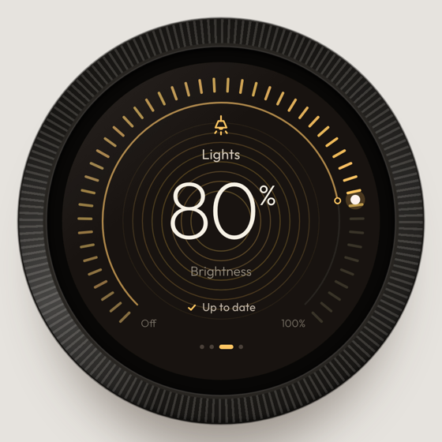
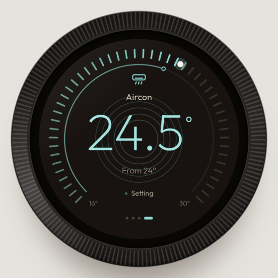
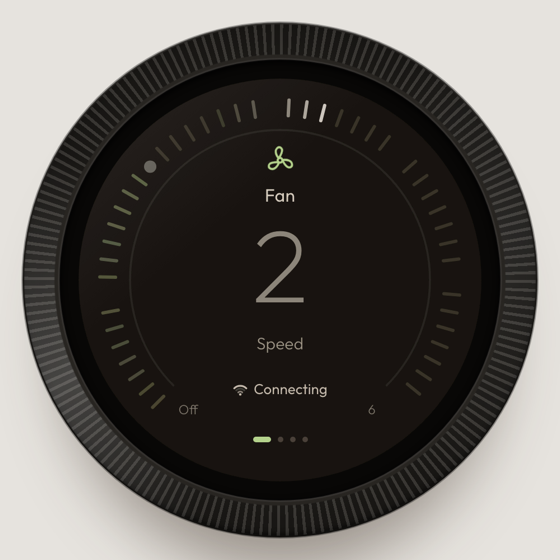
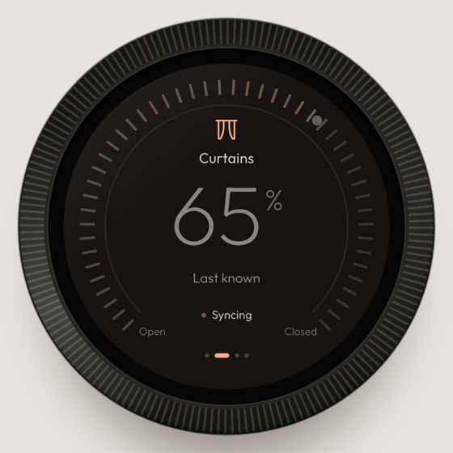

<h1 align="center">kuru</h1>

<p align="center"><b>A smart-home dial for Home Assistant.</b><br>
Turn the knob to change something, swipe to pick what, and see at a glance whether the house has caught up.</p>

## What is it?

kuru is firmware for a rotary knob with a touchscreen on top, the **Waveshare ESP32-S3-Knob-Touch-LCD-1.8**. You turn the knob to set
lights, aircon, a fan or curtains. The ring shows what you are asking for, and a thin line inside it shows what the house has
reported back. When they meet, the room has caught up.

It is made to live on a battery: the screen dims after 20 seconds, turns off after 30, and wakes when you spin the knob or
double-tap the glass.

## The four screens

Each picture below also shows a different moment in the screen's life.

<table>
  <tr>
    <td align="center"><br><b>Lights</b><br><i>Up to date</i>: fresh state has just arrived</td>
    <td align="center"><br><b>Aircon</b><br><i>Setting</i>: you turned it, the command is on its way</td>
  </tr>
  <tr>
    <td align="center"><br><b>Fan</b><br><i>Connecting</i>: waking up, joining Wi-Fi, last state shown muted</td>
    <td align="center"><br><b>Curtains</b><br><i>Syncing</i>: asking Home Assistant what changed (0 % open ... 100 % closed)</td>
  </tr>
</table>

Swipe left or right, or double-tap, to move between them. These pictures are renders of the design prototype, which the firmware follows.
The prototype is a hand-built web page you can open in a browser:
[`reference/knob-ui-prototype.html`](reference/knob-ui-prototype.html) (download the file and open it; turn with the arrow keys).

## What it does well

- **Feels like a real dial.** A slow turn moves one step per click; on the lights and curtains a fast spin speeds up to 3x, and it drops back to
  fine steps the moment you slow down.
- **Never lies about what the house is doing.** What you ask for, what was sent and what came back are tracked separately, so a late or
  failed answer never yanks your dial backwards.
- **Wakes up gracefully.** It shows the last thing it knew, muted, while it reconnects, then lights up when fresh state arrives, and
  tells you what changed while it slept.
- **Fast on a slow screen.** Full-screen redraws take about 100 ms, so almost everything on screen is a pre-drawn image.

## What you need

- The **Waveshare ESP32-S3-Knob-Touch-LCD-1.8**. kuru is written for this exact board; another board would need new display and input code
  (see [`docs/hardware.md`](docs/hardware.md)).
- A computer with Python 3 and [PlatformIO](https://platformio.org/), and a USB-C cable.

## Try it

```sh
python3 firmware/tools/gen_assets.py     # once: draws the image assets (about 10 s)
cd firmware
pio run -e knob -t upload                # build and flash (the first build takes a while)
pio device monitor                       # watch the logs and use the console
```

Then give it your Wi-Fi, by typing at the `kuru>` prompt in the monitor. It is saved on the board, never in the code:

```
kuru> wifi set MyNetwork my-password
kuru> wifi status
```

> **If the board will not flash or does not show up: flip the USB-C plug.** The board has two chips behind one port and the plug
> orientation picks which one your computer sees. If it says "This chip is ESP32, not ESP32-S3", turn the plug over.

## Where it is today

| Works | Not yet |
|---|---|
| All four screens, the dial feel, touch gestures, sleep and wake | Talking to a real Home Assistant (a stand-in answers for now: MQTT is next) |
| Joining Wi-Fi, the reconnect animation, queued commands | Haptics, battery and deep sleep, an all-devices overview |

## Going deeper

- [`docs/architecture.md`](docs/architecture.md): how the code is organised and how a turn of the knob becomes a command
- [`docs/lessons.md`](docs/lessons.md): what we learned (screen speed, build quirks, the USB trap, Wi-Fi); worth a read if you build something similar
- [`docs/hardware.md`](docs/hardware.md): what we know about the board, and how sure we are
- [`firmware/README.md`](firmware/README.md): build details and every `wifi` command
- Tests run on your computer without the board: `sh tests/run.sh`

## Licence

[MIT](LICENSE). The Outfit font is under the SIL Open Font License ([`third_party/Outfit-OFL.txt`](third_party/Outfit-OFL.txt)); LVGL (MIT)
and ESP-IDF (Apache-2.0) are downloaded by the build. The display's start-up register table came from an unofficial copy of Waveshare's
demo code and its licence has not been checked, so verify it against Waveshare's download before you redistribute.
kuru is not affiliated with Waveshare, Espressif or Home Assistant.
